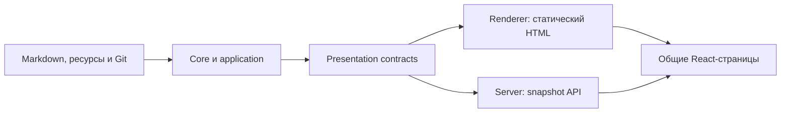

<!-- toudocu
architectureQuestion: Что делает серверный runtime, а что — код в браузере?
-->

# Граница серверного runtime и браузера

TypeScript core и application владеют документационной моделью, безопасностью,
Git, файловыми операциями и запуском процессов. Portal mapper преобразует модель
в проверяемые `PortalSnapshotV1` и `PageViewV1`. React получает только эти
проекции и доступные в текущем режиме capabilities.

## Поток данных

`build` загружает готовый renderer и browser assets, предварительно рисует все
публикуемые маршруты и заменяет выходной каталог только после успешной сборки.
Основной текст, навигация и ссылки находятся в HTML до запуска JavaScript.
Статический транспорт разделён на компактный общий `StaticPortalIndexV1`,
отдельные `PageViewV1` и лениво загружаемый поисковый индекс. Браузер получает
только текущую страницу и явно перечисленные дополнительные представления,
а не содержимое всех документов. Статические ссылки переходят между HTML-
страницами; общие сведения о документах позволяют показывать названия и связи
без загрузки их полных текстов.

`serve` раздаёт тот же снимок и единый SPA shell. React Router управляет
переходами, а watcher публикует новую revision только после успешной
перестройки. Панель терминала находится выше route outlet, поэтому процесс и его
представление переживают навигацию. xterm загружается только после запуска PTY.

Браузер отвечает за отображение, маршрутизацию, формы и локальное состояние. Он
не разбирает Markdown, не вычисляет готовность задач, Git diff или права
доступа, не выбирает executable, argv, cwd и environment. Изменяющие запросы
повторно проверяются сервером, требуют известный action header и same-origin
контекст.

## Инварианты

- core не содержит React, HTTP и Node.js-адаптеров;
- React не реконструирует доменную семантику из UI;
- статический портал читаем без JavaScript и работает во вложенном URL;
- статический режим не содержит editor, Discussions или PTY;
- только loopback `serve` может запускать системную оболочку;
- ошибка интерактивной функции не скрывает содержимое документа;
- завершение CLI отменяет перестройку и закрывает watcher, сервер и PTY.

Решение о миграции закреплено в [ADR-012](../decisions/ADR-012.md). Границы
доверия описаны отдельно в [trust-boundaries.md](trust-boundaries.md).
